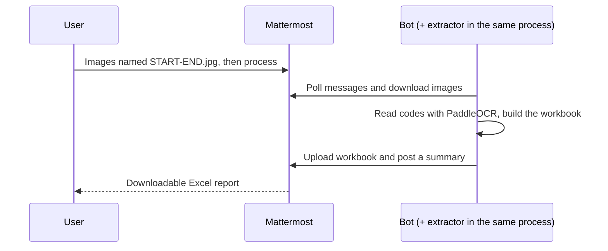

# Pixel2Num

A Dockerized Python bot for the operations team. Operators send photos of top-up cards in a Mattermost direct message, and the bot replies with an Excel file of the recharge codes it read with OCR (PaddleOCR).

The bot and the extractor ([pixel2num/extract_numbers.py](pixel2num/extract_numbers.py)) run in **one Python process in one container**. There is no HTTP API between them: the bot downloads the images, calls the extractor directly, and uploads the workbook.



## Start

1. Follow the [Mattermost setup and Docker guide](docs/mattermost-setup.md) to create the bot account.
2. Copy `.env.example` to `.env` and set the Mattermost URL and bot token.
3. Run `docker compose up -d --build`. The first build downloads the OCR models into the image and takes a while.
4. Open a DM with `pixel2num`, send images, wait for acknowledgement, then send `process`.

## Naming the image files (required)

**Every image file must be named `START-END`**, for example `81-100.jpg`. START is the counter written on the first (top) card in the photo and END the counter on the last card, so `81-100.jpg` holds 20 cards numbered 81 to 100, read from top to bottom. The report uses these numbers, so nobody has to read the handwriting.

If any file in a message has a different name (for example a phone's `IMG_1234.jpg`), or END is smaller than START, or the range has more than `MAX_CARDS_PER_IMAGE` cards, the **whole message is rejected**. The bot names the bad files and nothing from that message is added; rename and send it again. Captions are ignored and are never used as a range.

| Message | Action |
| --- | --- |
| Image attachments named `START-END` | Add images to your pending batch; the reply lists the ranges added and warns if ranges overlap |
| `process` | Submit pending images |
| `status` | Show pending image count and latest job state |
| `clear` | Clear pending images; submitted jobs continue |
| `retry` | Retry your latest failed job |
| `help` | Show instructions |

Commands are ordinary messages, not slash commands. PNG, JPEG, WebP, TIFF and BMP are supported. Channels and group messages are ignored. Each user's DM has its own batch. `ALLOWED_USER_IDS` optionally restricts access.

## The report

One row per card: **Image | Counter | Charge Code | Status**. Rows are sorted by the Counter column, from the smallest to the biggest, whatever order the images were sent in. The code is stored as text. Status is `succeeded`, `failed` (code not read completely; the row stays so counters never shift) or `repeated` (the same code appears more than once in the batch; every copy is marked). The chat message gives only the counts, never the codes.

The extraction rules (card types, code length detection, retries with more contrast) are described at the top of [extract_numbers.py](pixel2num/extract_numbers.py). The same file works as a command-line tool: `python -m pixel2num.extract_numbers <folder> results.xlsx [--debug] [--layout=left] [--len=15]`.

## Development

This project is built spec-first: see [SPEC.md](SPEC.md) (requirements), [HARNESS.md](HARNESS.md) (how each is checked) and [CLAUDE.md](CLAUDE.md) (working rules).

Python 3.13 on Linux. Fast tests need no OCR packages:

```sh
python3 -m venv .venv
.venv/bin/pip install -r requirements-dev.txt
.venv/bin/python -m unittest discover -s tests -v
```

Running the real extractor locally needs the full set (large download):

```sh
python3 -m venv .venv-ocr
.venv-ocr/bin/pip install -r requirements.txt
DATA_DIR=./data MATTERMOST_URL=... MATTERMOST_TOKEN=... .venv-ocr/bin/python -m pixel2num
```

Python does not automatically load `.env`; Compose does. Tests use mocks and do not prove live Mattermost permissions, deployment success, or extraction accuracy. Run the setup guide's live smoke test before deployment.

## Operating limits

- Run one replica per bot account and persistent volume. A filesystem lock prevents workers sharing the same local directory. Separate volumes for the same account would cause duplicate processing.
- Jobs run one at a time, and OCR runs inside the bot process. **While a job runs, the bot does not poll or reply**; messages sent meanwhile are handled afterwards. A batch of 20+ photos can take several minutes. A running job cannot be cancelled. This is acceptable for a small team; for heavier use, move the extractor to a separate worker.
- Memory: PaddleOCR is loaded once at startup (the first start takes a while) and stays in memory. The Compose file limits the container to 4 GB; adjust after measuring on your server.
- The OCR models are baked into the image, so the container needs no internet access for them.
- The first start ignores old history (with a one-second overlap). Later starts recover messages since saved cursors. Edits are not reprocessed; resend corrections. Deleted or unavailable attachments can cause failures.
- SQLite deduplicates incoming posts and checkpoints results/uploads. An interrupted job restarts extraction from the saved file references.
- A crash or timeout around Mattermost upload/post can still leave an orphan upload or duplicate reply/report. Delivery is not exactly-once.
- Failed jobs require `retry`; saved reports are reused when available. `clear` does not cancel submitted jobs.
- **Charge codes are sensitive.** They never appear in logs or chat text, only in the delivered workbook. Temporary image files are deleted after each job. State includes pending file references, job metadata, cursors, deduplication IDs, and undelivered reports. Completed report blobs and inbox bodies are cleared logically; SQLite free pages/backups can retain bytes. Metadata has no automatic expiry. Protect and back up the volume and plan retention. Mattermost keeps the uploaded images and reports.
- Configure per-image, batch, and report limits in `.env`. The bot's MIME/ZIP checks are preliminary validation only.
