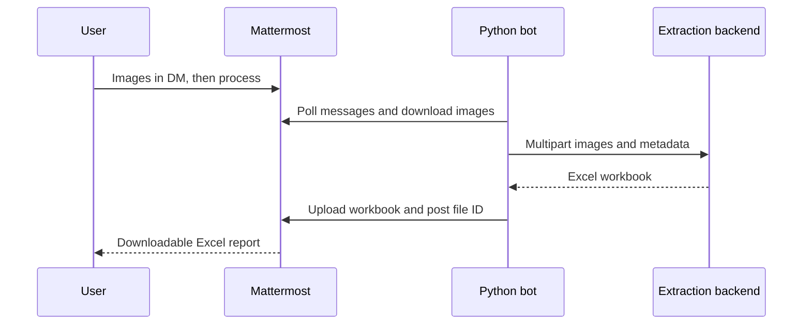

# Pixel2Num

A Dockerized Python bot that collects images in Mattermost direct messages, submits them to your extraction backend, and returns an Excel file in the same conversation.

**This repository implements the bot.** OCR, numerical extraction, the predefined report format, and Excel generation belong to your backend service. No extraction backend is bundled. See the [backend contract](docs/backend-contract.md) for your backend developer.



## Start

1. Follow the [Mattermost setup and Docker guide](docs/mattermost-setup.md) to create the bot account.
2. Copy `.env.example` to `.env` and configure the Mattermost URL, bot token, and reachable backend endpoint.
3. Run `docker compose up -d --build`.
4. Open a DM with `pixel2num`, send images, wait for acknowledgement, then send `process`.

| Message | Action |
| --- | --- |
| Image attachments | Add images to your pending batch; captions are ignored |
| `process` | Submit pending images |
| `status` | Show pending image count and latest job state |
| `clear` | Clear pending images; submitted jobs continue |
| `retry` | Retry your latest failed job |
| `help` | Show instructions |

Commands are ordinary messages, not slash commands. PNG, JPEG, WebP and TIFF are supported. Channels and group messages are ignored. Each user's DM has its own batch. `ALLOWED_USER_IDS` optionally restricts access.

## Development

Python 3.13 on Linux:

```sh
python3 -m venv .venv
.venv/bin/pip install -r requirements.txt
.venv/bin/python -m unittest discover -s tests -v
```

To run locally, export the environment variables from `.env.example` with real values, then use `DATA_DIR=./data .venv/bin/python -m pixel2num`. Python does not automatically load `.env`; Compose does.

Tests use mocks and do not prove live Mattermost permissions, deployment success, or extraction accuracy. Run the setup guide's live smoke test before deployment.

## Operating limits

- Run one replica per bot account and persistent volume. A filesystem lock prevents workers sharing the same local directory. Separate volumes for the same account would cause duplicate processing.
- Jobs run sequentially. Polling and acknowledgements pause during extraction, then catch up. High-volume or long-running extraction should use separate workers and an asynchronous backend contract.
- The first start ignores old history (with a one-second overlap). Later starts recover messages since saved cursors. Edits are not reprocessed; resend corrections. Deleted or unavailable attachments can cause failures.
- SQLite deduplicates incoming posts and checkpoints results/uploads. Interrupted processing restarts with the same backend idempotency key. The backend must implement idempotency.
- A crash or timeout around Mattermost upload/post can still leave an orphan upload or duplicate reply/report. Delivery is not exactly-once.
- Failed jobs require `retry`; saved reports are reused when available. `clear` does not cancel submitted jobs.
- State includes pending file references, job metadata, cursors, deduplication IDs, and undelivered reports. Completed report blobs and inbox bodies are cleared logically; SQLite free pages/backups can retain bytes. Metadata has no automatic expiry. Protect and back up the volume and plan retention. Mattermost and backend retain their own files.
- Configure per-image, batch, and report limits in `.env`. Allow memory for multiple copies of a batch during multipart encoding. The backend must validate actual image contents and safely generate workbooks; bot MIME/ZIP checks are preliminary validation only.
